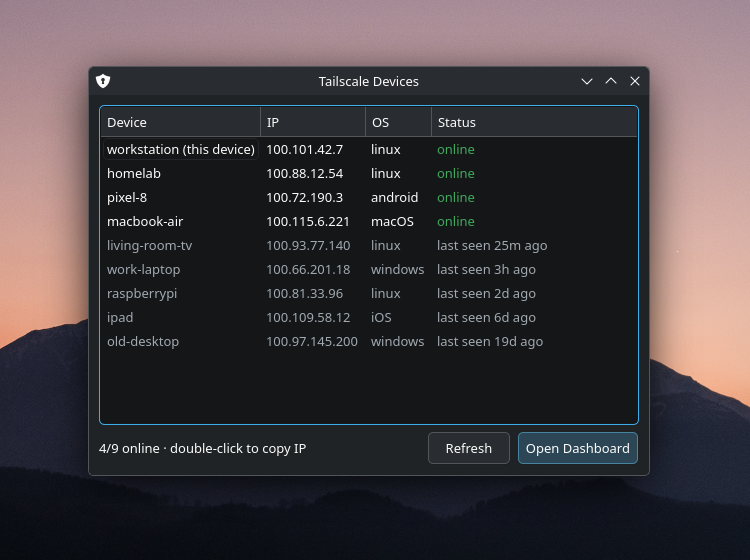

# tailnet-devices

A tiny KDE tray app for Tailscale.

- **Tray icon** shows at a glance whether Tailscale is up: a shield
  (`network-vpn-symbolic`) when connected, a shield with a red ✕
  (`security-low-symbolic`) when stopped, logged out, or `tailscaled` isn't
  running. Hover for "connected · 2/10 online".
- **Left-click** opens a window listing every device on the tailnet: name,
  IP, OS and status. Online devices first, then offline ones by most recently
  seen ("last seen 1h ago"). Double-click a device to copy its IP.
- **Open Dashboard** opens the Tailscale admin console in your browser.
- Closing the window tucks it back into the tray; right-click for Quit.

Polls `tailscale status --json` every 10 s, and only redraws the list while
the window is open, so it's fine to leave running (~90 MB, mostly Qt).
Launching it again while it's running just shows the existing window.

## Requirements

- `python-pyqt6`, `tailscale`
- A system tray (tested on KDE Plasma 6 Wayland)

## Install

    ./install.sh

Installs `~/.local/bin/tailnet-devices`, a launcher entry ("Tailscale
Devices"), and an autostart entry that starts it in the tray at login
(`--hidden`). Re-run after editing to update.

If the icon lands in the tray's hidden overflow, set it to **Always shown**
under Configure System Tray → Entries.
